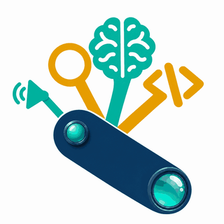

<p align="center"></p>

# Scope Your Skills

*See, sort and de-duplicate every agent skill on your machine.*

**Which of my agent skills do I actually have, what are they for, and which ones step on each other?**

Scope Your Skills scans every `SKILL.md` on your machine (Claude Code, Claude Desktop plugins, Codex, Gemini/Antigravity, and any folder of downloaded repos), groups the skills by theme and finds overlaps. The result is one offline HTML dashboard.

**English** · [Türkçe](README.tr.md)

## What you get

- **Explore:** totals (unique, installed, downloaded only) and install status by theme. The *live overlaps* tile jumps straight to the overlaps page.
- **Skill catalog:** skills grouped by category, then by package. Each package header shows its name, author, short description and GitHub link. Each package (its header and its skills) shares one band colour and a light or dark shade of the category colour, so you see where one skill set ends and the next begins.
- **Readable names:** `bio-research:instrument-data-to-allotrope` shows as *Instrument Data to Allotrope*; the technical id stays in the detail panel.
- **Status and actions:** every row is tagged *Installed*, *Installed elsewhere* or *Not installed*. *Open* shows details (paths, similar skills); *Install* copies a ready-made command that copies the skill into `~/.claude/skills` (the page itself never touches your files).
- **Stars and licenses:** with `--github`, each package shows its GitHub stars and license (MIT in green; non-commercial, proprietary and unknown licenses highlighted). Licenses are read from the package's own `LICENSE` file first; a `*` marks a mismatch with GitHub.
- **Four languages:** the interface switches between Türkçe, English, 中文 and Español with the flags in the sidebar.
- **Description language:** switch between the original text and your language (`--lang`). See [Translations](#translations).
- **Repo report card:** for each downloaded repo, how many skills you already have, how many duplicate something you have, and how many are genuinely new.
- **Overlaps card**, split by how much it matters:
  - *Live overlaps:* two skills from different packages, both loaded by the same tool, describing the same job. These compete for the same requests.
  - *Within one package:* look-alike siblings (usually by design).
  - *Downloaded ↔ installed:* a downloaded skill that duplicates one you already use.
  - *Same name, different version:* which one loads may be unclear.
  - *Exact copies:* byte-identical files in several places.

## Modes

- **Usage** (`--usage`): which installed skills actually fire, how often, in how many sessions, when last, and how many tokens Claude Code attributes to them. Never-used skills are listed with an estimate of the context they still take up in every session (description length / 4, an upper bound). Read from the local Claude Code transcripts; only skill names, dates, session ids and token counts are read.
- **X-ray:** each skill as a flow (trigger, sections, steps, decisions, tools, outputs, links to other skills) with a 0-100 quality score in five parts and concrete fixes.
- **Audit:** structural checks that cost no tokens (front matter, name matches folder, name format, description length, body over 500 lines, files named in the body but missing) and a **routing simulator**: type a request and see which skills' descriptions match it, with a warning when two are close.

## Use it as a Claude skill (recommended)

Clone the repo into your personal skills folder and ask Claude for it:

```bash
git clone https://github.com/ertenemirarif/scopeyourskills.git ~/.claude/skills/scopeyourskills
```

Then say *"scope your skills"* (or *"skill envanterimi çıkar"*). Claude scans, translates the missing descriptions into English, Turkish, Chinese and Spanish itself (no API key), builds the dashboard and opens it. Ask for another language ("also in German") and it adds that too. The steps are in [SKILL.md](SKILL.md).

## Quick start (without Claude)

Python 3.9+ only, no packages to install. On Windows, use `py -3` wherever this README says `python`.

```bash
git clone https://github.com/ertenemirarif/scopeyourskills.git
cd scopeyourskills
python scopeyourskills.py --open
```

Add folders of downloaded repos (these count as *not installed*):

```bash
python scopeyourskills.py --path "Downloaded=~/Downloads/skill-repos" --open
```

| Option | Meaning |
|---|---|
| `--path LABEL=DIR` | Extra folder to scan as *downloaded* (repeatable) |
| `--active-path LABEL=DIR` | Extra folder whose skills Claude loads, e.g. a project's `.claude/skills` |
| `--no-defaults` | Skip the auto-detected install locations |
| `--threshold 0.25` | Similarity cut-off for overlaps (0-1). Higher means fewer, stronger matches |
| `--lang en` | Default dashboard language (default: `tr`) |
| `--langs tr,en,zh,es` | Languages to prepare description translations for |
| `--usage` | Count how often each installed skill fired, from local Claude Code transcripts (read-only) |
| `--github` | Fetch stars and licenses from GitHub (uses `GITHUB_TOKEN` or your `gh` login, cached 24 h) |
| `--export-missing DIR` / `--merge LANG FILE` | Export untranslated descriptions per language, merge translated files back |
| `--categories FILE` | Your own theme rules |
| `--out DIR` | Output folder (default `output/`) |

Output: `output/scopeyourskills.html` and `output/skills.json`.

## Claude artifact and weekly refresh

- Every build also writes `output/scopeyourskills.artifact.html`. You can publish it as a private claude.ai artifact; the skill offers to do this for you.
- **Weekly refresh, two options:**
  - Ask the skill to set up a weekly Claude scheduled task. It re-scans, translates new skills and republishes the artifact.
  - Without Claude, add `--schedule weekly` to your usual command. This registers a Windows Task Scheduler job or prints a cron line, and only rebuilds the HTML. Remove it with `--schedule off`.

## Translations

Descriptions already in your language are shown as they are. The others come from a cache, `translations/<lang>.json` (`{key: text}`), which you can fill in three ways:

1. **Claude API:** `ANTHROPIC_API_KEY=... python scopeyourskills.py --lang tr --translate` translates what is missing and caches it (model: `--model`, default `claude-haiku-5-5`).
2. **Any translator (or Claude via the skill):** `python scopeyourskills.py --export-missing todo/` writes `todo/missing-<lang>.json`; translate the values and run `python scopeyourskills.py --merge <lang> file.json`.
3. **In the browser:** if nothing is cached and the browser has the built-in Translator API (recent desktop Chrome), the dashboard translates on the device and remembers the result.

Anything still untranslated is shown in the original with a "not translated" mark.

## How it works

- **Themes:** keyword rules in [`categories.json`](categories.json) (English and Turkish). Hits in the skill name count 3×, the strongest theme wins, and close runners-up appear as secondary themes. Edit the file to add your own themes.
- **Overlaps:** TF-IDF cosine similarity over each skill's name and description. That text is what the agent reads to decide which skill to use, so similar descriptions mean competing triggers. Skills from the same repo need a higher score (+0.13), because siblings share vocabulary by design.
- **Installed vs downloaded:** auto-detected locations count as installed. A downloaded skill is marked if the same content or name is already installed somewhere.

Known limits: keyword themes are a heuristic, so a few skills land in *Other* or in a neighbouring theme. Similarity is lexical, so two skills that do the same job in very different words can be missed.

## Privacy

Scanning runs locally. `--usage` reads your Claude Code transcripts locally and keeps only skill names, dates and token counts. Data leaves your machine only when you ask for it: `--github` sends the owner/name of linked GitHub repos to api.github.com, and translation (by Claude through the skill, or `--translate` with the Claude API) sends skill descriptions to Claude. The dashboard contains your local paths and skill descriptions, so look it over before sharing it. `output/`, `translations/` and `cache/` are git-ignored.

## Tests

```bash
python -m unittest discover -s tests
```

## Acknowledgements

Three projects that share the name SkillScope inspired the modes; their code was not copied:

- [notsointresting/skillscope](https://github.com/notsointresting/skillscope) (MIT): reading Claude Code transcripts to find which skills fire, token attribution through `attributionSkill`, and the idle-overhead estimate.
- [silvesterdivas/skillscope](https://github.com/silvesterdivas/skillscope): a SKILL.md as a flowchart with a quality score.
- [amd/skillscope](https://github.com/amd/skillscope) (MIT): structural and routing tests for skills.

## License

MIT
